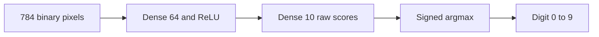

# MNIST Digit Recognizer on FPGA

DISCLAIMER: The initial aspect of training the neural network was done with AI assistance. Everything else is done by hand.

This project implements a binary-input MNIST recognizer for Basys 3. The v1
model is a 784 to 64 to 10 MLP with hidden ReLU and raw output scores. Python
training, quantization, integer reference inference, hardware parameter exports,
and RTL test vectors are complete. FPGA implementation follows in later phases.
The small CNN in v2 is a planned upgrade.

[Project specification](docs/MNIST_FPGA_Spec.pdf) | [Phase 1 results](docs/phase1_results.md)



## Results

| Check | Result |
|---|---:|
| Float test accuracy | 97.43% (9,743 / 10,000) |
| Integer test accuracy | 97.42% (9,742 / 10,000) |
| Accuracy loss | 0.01 percentage points; allowed 1.00 |
| Float hidden neurons inactive on all measured images | 1 / 64, index 13 |
| Accumulator overflow or observed saturation | None |
| Parameter export and reload | Exact |
| Full export comparison | 640,000 hidden values, 100,000 scores, 10,000 digits matched |
| RTL vector sets | 10, 1,000, and 10,000 images verified |
| Python test suite | 34 tests passed |

These results verify the Python reference and file exports. RTL equivalence,
resource utilization, timing, and board performance are measured in later phases.

## Set up Python

Use Python 3.12. From the repository root in PowerShell:

```powershell
python -m venv .venv
.\.venv\Scripts\python.exe -m pip install -r requirements.txt
.\.venv\Scripts\python.exe -m pip check
.\.venv\Scripts\python.exe python\data.py
```

The first data-loader run downloads MNIST into `data/MNIST/`; later runs reuse
it. The supplied local environment uses Python 3.12.14 and CPU PyTorch.
`requirements.txt` pins the installed packages and official PyTorch CPU index.
Calling the environment's Python directly makes activation optional.

## Verify the supplied artifacts

The trained checkpoints, hardware parameters, and expected vectors are included,
so training is unnecessary for verification. After loading MNIST:

```powershell
.\.venv\Scripts\python.exe python\check_arithmetic_rules.py
.\.venv\Scripts\python.exe python\verify_phase1.py
```

The final verifier runs all 34 tests and checks checkpoint provenance and hashes
of 23 parameter/vector files against their full-evaluation reports. Full
10,000-image inference and export checks can be repeated with:

```powershell
.\.venv\Scripts\python.exe python\evaluate_quantized.py
.\.venv\Scripts\python.exe python\export_mem.py
.\.venv\Scripts\python.exe python\export_vectors.py
```

Reports go to `docs/`. Vector export verifies every generated file and recomputes
all layer outputs from the reloaded input images.

## Reproduce training and exports

Run the following commands in order from the repository root:

```powershell
.\.venv\Scripts\python.exe python\data.py
.\.venv\Scripts\python.exe python\train.py
.\.venv\Scripts\python.exe python\count_dead_neurons.py
.\.venv\Scripts\python.exe python\quantize.py
.\.venv\Scripts\python.exe python\golden.py
.\.venv\Scripts\python.exe python\evaluate_quantized.py
.\.venv\Scripts\python.exe python\export_mem.py
.\.venv\Scripts\python.exe python\export_vectors.py
.\.venv\Scripts\python.exe python\verify_phase1.py
```

Training uses seed 42, 40 epochs, batch size 128, Adam, and a cosine learning
rate schedule from 0.001 to 0.0001. A seeded 5,000-image validation holdout
leaves 55,000 images for optimizer updates. Training images receive random
zero-filled translations of up to two pixels; validation and test images are
unchanged. The best validation accuracy selects the checkpoint, with loss
breaking ties. Test accuracy is measured after selection.

Deterministic PyTorch algorithms are enabled. Exact reproduction depends on
matching the recorded software/runtime settings. Regeneration overwrites default
outputs; use each script's `--help` to choose separate experiment paths.

## Integer arithmetic

[The arithmetic contract](docs/integer_arithmetic.md) defines the shared Python
and RTL rules. Inputs are 0/1; weights are signed 8-bit; biases and accumulators
are signed 32-bit; activations and scores are signed 16-bit. Parameter conversion
rounds to nearest with ties to even. Runtime processing uses arithmetic right
shift, saturation, then optional ReLU. Equal scores choose the lowest digit index.

| Layer | Input fraction | Weight fraction | Bias fraction | Output fraction | Shift | ReLU |
|---|---:|---:|---:|---:|---:|---|
| Hidden dense | 0 | 7 | 7 | 7 | 0 | Yes |
| Output dense | 7 | 6 | 13 | 6 | 7 | No |

A value with F fractional bits represents its stored integer divided by 2**F.
Scales use conservative interval bounds over binary inputs, with no weight or
bias clipping. Both layers' bounds cover every intermediate MAC sum.

## Files

| Location | Contents |
|---|---|
| `python/data.py` | MNIST loading, thresholding, and sample preview |
| `python/model.py`, `python/train.py` | Float MLP and reproducible training |
| `python/count_dead_neurons.py` | Dataset-level hidden-neuron activity |
| `python/quantize.py`, `python/golden.py` | Integer parameters and reference inference |
| `python/evaluate_quantized.py` | Full float/integer accuracy and overflow checks |
| `python/export_mem.py`, `python/export_vectors.py` | Hardware files and verified RTL vectors |
| `python/test_*.py`, `python/verify_phase1.py` | Testbenches and final verification |
| `artifacts/` | Saved float and integer checkpoints; baseline checkpoint |
| `docs/` | Specification, arithmetic contract, results, logs, preview, verification |
| `mem/` | Weights, biases, shifts, layer table, and configuration |
| `mem/vectors/` | Input and expected-output sets for 10 / 1,000 / 10,000 images |

[ROM loading and layout](mem/README.md) and [vector loading and offsets](mem/vectors/README.md)
provide `$readmemh` examples. Use golden predictions for exact RTL checks and
true MNIST labels for recognition accuracy. The environment, raw dataset,
Python caches, and temporary files are excluded from Git.

The Phase 1 Git milestone is `v0.1-python`. Phase 2 starts with separately tested
MAC, requantization/ReLU, activation buffer, weight ROM, dense address generator,
and argmax modules.
